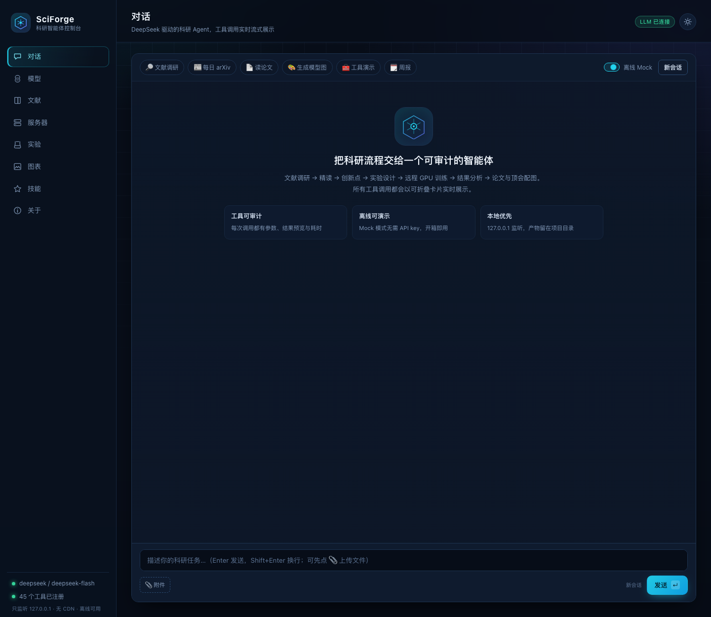
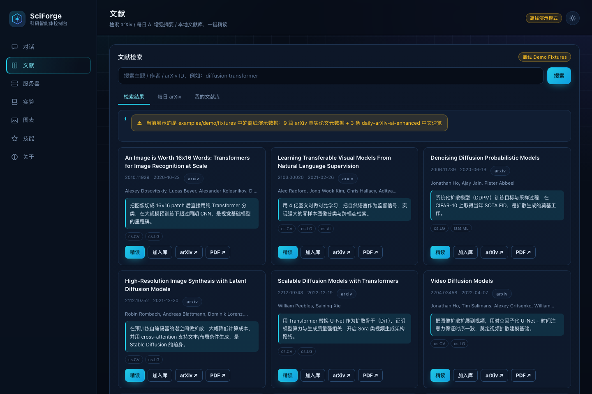
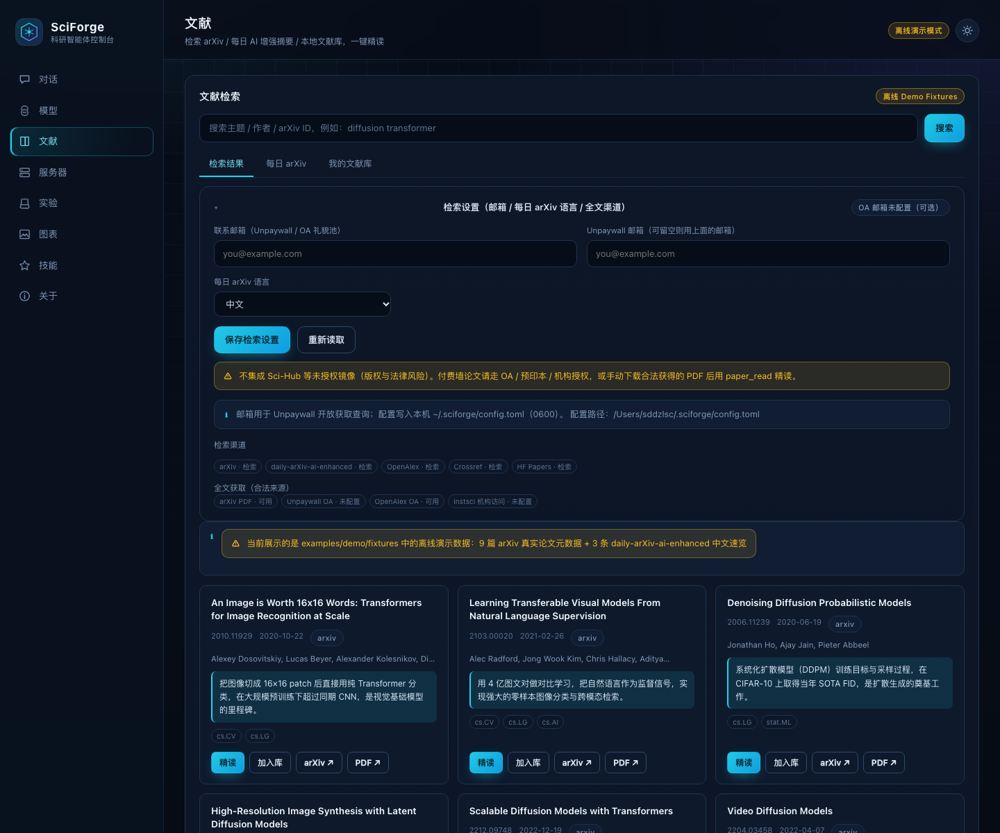

# SciForge · 深度学习科研智能体 Harness

> **本地运行 · DeepSeek 驱动 · 可 SSH 调度 GPU 集群 · 从文献到顶会论文与配图**
>
> 文献获取 → 读论文 → 找创新点 → 模块化实验 → 远程训练 → 结果分析 → 论文写作 → 顶刊/顶会级模型图

SciForge 把深度学习科研（CV / NLP / 大模型 / 多模态）拆成一组**可排列组合的模块**：
Skill（科研方法论）+ Tool（确定性能力）+ Pipeline（可组合工作流）+ Recipe（成套打法）。
它默认由 **DeepSeek** 驱动，也支持任意 OpenAI 兼容 LLM（vLLM / Ollama / OpenRouter / 硅基流动 / 公司内网），
并可与 **DSH（DeepSeek Harness）** 互通：把科研 Skill 装进 `~/.dsh/skills`，让 DSH 直接调用这套 Harness。

```text
                 ┌──────────────────────────── SciForge Harness ────────────────────────────┐
  CLI / Web UI → │ Agent Loop (ReAct)  →  Tool Registry  →  LLM Router (DeepSeek / 自定义 API) │
                 │        │                    │                                        │
                 │        ├─ Skills (方法论)     ├─ 文献 / 精读 / 创新点                    │
                 │        ├─ Recipes (编排)      ├─ SSH GPU / Slurm / 实验管理               │
                 │        └─ Pipeline (DAG)      ├─ 论文写作 / 顶会级配图 / 审稿自检           │
                 └──────────────────────────────────────────────────────────────────────────┘
```

---

## 目录

- [为什么是 SciForge](#为什么是-sciforge)
- [整合的开源生态](#整合的开源生态)
- [核心能力](#核心能力)
- [快速开始](#快速开始)
- [连接 GPU 服务器](#连接-gpu-服务器)
- [科研工作流](#科研工作流)
- [论文写作与顶会级配图](#论文写作与顶会级配图)
- [Skill 体系与 DSH 集成](#skill-体系与-dsh-集成)
- [自定义 LLM API](#自定义-llm-api)
- [本地 Web 控制台](#本地-web-控制台)
- [文献获取与配置](docs/LITERATURE.md)
- [目录结构](#目录结构)
- [Roadmap 与已知限制](#roadmap-与已知限制)
- [致谢](#致谢)

---

## 为什么是 SciForge

通用 coding agent 能写代码，但科研还缺四样东西：**可信的文献上下文、可证伪的实验编排、可追溯的科研状态、可投稿的成果形态**。

SciForge 的取舍：

| 问题 | SciForge 的做法 |
|---|---|
| 论文/引用幻觉 | 文献工具只返回真实检索结果；写作阶段数字必须来自 `results/` 真实文件；审稿阶段强制核对 |
| 实验散落不可复现 | 每次运行写 `run.json`（命令/seed/服务器/git commit/日志）；结果统一进 `results/` |
| 想法到实验断层 | Pipeline 阶段化：调研 → 精读 → 创新点 → 设计 → 代码 → 训练 → 分析 → 写作 → 配图 → 自检 |
| 工具割裂 | 统一 Tool 契约 + Skill 方法论 + Recipe 编排，可任意拼接（`survey` / `experiment` / `paper` / `full`…） |
| GPU 调度麻烦 | `gpu status` / `exp launch` / tmux / Slurm / 日志轮询 / 结果回收，一条命令 |
| 图不够“论文感” | 声明式模型架构图 DSL → SVG/PDF；NeurIPS/CVPR 风格数据图；booktabs 三线表 |
| 厂商锁定 | DeepSeek 为默认，任意 OpenAI 兼容服务 + 按角色路由不同模型 |

## 整合的开源生态

SciForge 不是从零发明，而是把下列公开生态的能力**重组为一个可本地运行的 Harness**：

| 来源 | 吸收了什么 | 在 SciForge 中的形态 |
|---|---|---|
| [huggingface/ml-intern](https://github.com/huggingface/ml-intern) | Agent 循环、工具注册、会话持久化、CLI/Web 双入口 | `sciforge/agent`、`sciforge/core/registry.py`、CLI + Web |
| [k-dense-ai/scientific-agent-skills](https://github.com/k-dense-ai/scientific-agent-skills) | 科研 Skill 的渐进披露规范与写作范式 | `sciforge/skills_lib/`、`SkillManager` |
| [InternScience/Awesome-Scientific-Skills](https://github.com/InternScience/Awesome-Scientific-Skills) | 科研 skill 分类体系、skill-metric 质量评分 | Skill 分类、`sciforge skills lint` |
| [orchestra-research/AI-research-SKILLs](https://github.com/orchestra-research/AI-research-SKILLs) | 双循环自主科研（inner experiment / outer synthesis）、`research-state.yaml` 工作区、论文写作与学术制图技能 | Pipeline 状态文件（`research-state.yaml` / `findings.md` / `research-log.md`）、autoresearch 类 Skill、写作/配图规范 |
| [dw-dengwei/daily-arXiv-ai-enhanced](https://github.com/dw-dengwei/daily-arXiv-ai-enhanced) | 每日 arXiv + DeepSeek 中文增强摘要数据流 | `lit_daily`、`daily` recipe、每日速览 |
| [Rimagination/instsci](https://github.com/Rimagination/instsci) | 开放获取优先 + 机构访问（WebVPN/CARSI/EZproxy）的论文获取路线 | `paper_fetch` 的 OA 优先策略与 instsci 集成 |
| [skills.scansci.com](https://skills.scansci.com/) · Rimagination 科研扩展（instsci / scansci-svg / easyplot / easyslides / easymd / good-question / good-story / easymeta / mineru-go / chuan-check …） | 科研 Agent 扩展生态目录与安装方式 | `sciforge/catalog/skills.json`、`sciforge skills install <name>` |
| [DeepSeek Harness (DSH)](https://github.com/deepseek-ai) | Skill 目录规范与宿主 Agent | `sciforge dsh install` → `~/.dsh/skills/` |

## 可视化 GUI（本地网页）

一条命令启动，浏览器里完成全部科研操作：

```bash
sciforge gui                                  # 启动本地控制台并自动打开浏览器（默认 127.0.0.1:8765）
sciforge gui --project ~/my-research --port 8765
sciforge serve --open                         # 等价写法；不自动开浏览器则用 sciforge serve
```

八个页面：**对话 / 模型 / 文献 / 服务器 / 实验 / 图表 / 技能 / 关于**

其中 **模型、服务器、文献设置都可以直接在网页里填空配置**，保存到本机 `~/.sciforge/config.toml`（0600），
每次保存/测试都有即时结果反馈：

| 配置 | 页面 | 填什么 |
|---|---|---|
| 大模型 Provider | 模型 | 名称 / Base URL / 模型 / API Key（或环境变量名）/ 角色路由；支持「保存并测试」 |
| GPU 服务器 | 服务器 | **粘贴 ssh 登录命令自动解析**，或填 host/端口/用户/私钥/**密码**；支持「保存并测试 SSH」 |
| 文献检索 | 文献 | 邮箱（Unpaywall OA）、每日 arXiv 语言；检索/全文渠道可用状态一目了然 |
| 文件上传 | 对话 / 服务器 | 对话附件（PDF/TXT/MD 自动读入上下文）；文件上传到 GPU（见 [docs/FILES.md](docs/FILES.md)） |

| 页面 | 能力 |
|---|---|
| 对话 | SSE 流式输出、工具调用折叠卡（参数/结果/耗时）、6 个科研快捷任务；无 API key 自动离线 Mock |
| 文献 | 实时 arXiv 检索、每日 arXiv 中文速览、本地文献库；一键「精读 / 入库 / PDF」 |
| 服务器 | GPU 服务器卡片 + nvidia-smi 状态表；未配置时显示本机 MPS 提示 |
| 实验 | 选 Recipe → 填研究主题 → 后台跑 pipeline → 阶段/事件/产物/历史，实时轮询 |
| 图表 | 论文级配图画廊：模型图 SVG/PNG、曲线 PDF、三线表，支持图片与 PDF 预览 |
| 技能 | 24 个科研 Skill 卡片、lint 状态、一键安装到 DSH |
| 关于 | 运行状态、工具清单、安全边界与 API 端点 |

安全约束：只监听 `127.0.0.1`（拒绝 0.0.0.0）；`/api/servers` 永不回传密钥；
`/figures`、`/files` 做项目根路径校验（拒绝目录穿越/符号链接逃逸）。

实跑截图（由 `sciforge gui` 启动后截取）：








## 核心能力

| 模块 | 能力 | 入口 |
|---|---|---|
| 📚 文献 | arXiv / OpenAlex / HF Papers / Crossref / 每日 arXiv 中文摘要；BibTeX；合法全文获取（arXiv/Unpaywall/OA/机构访问，不集成 Sci-Hub；见 [docs/LITERATURE.md](docs/LITERATURE.md)） | `sciforge lit ...`、`lit_search`、`lit_daily` |
| 📖 精读 | PDF → 章节结构 → 结构化笔记 / 对比矩阵 / 论文问答 | `sciforge read ...`、`paper_read`、`paper_note` |
| 💡 创新点 | 从文献空白生成 Idea Card（空白/洞察/方法/MVP/风险/评分）与 Proposal | `sciforge idea generate`、`idea_generate` |
| 🧪 实验 | 实验设计 → 代码脚手架（CV/NLP/LLM-SFT）→ 远程启动 → 状态/日志 → 指标回收 | `sciforge exp ...`、`exp_scaffold`、`exp_launch` |
| 🖥️ GPU | SSH 连接测试、GPU 状态、文件同步、tmux/Slurm 后台任务、日志轮询 | `sciforge ssh ...`、`sciforge gpu status` |
| ✍️ 写作 | LaTeX 工程（CVPR/NeurIPS/ICLR/ACL/通用）、章节生成、引用管理、编译检查、审稿自检 | `sciforge write ...`、`paper_*` |
| 🎨 配图 | 顶会风格模型架构图（声明式 DSL → SVG/PDF）、实验曲线、三线表 | `sciforge fig ...`、`figure_architecture` |
| 🧩 编排 | Recipe 流水线 + 科研状态文件 + 可中断/续跑 | `sciforge pipeline ...` |
| 🖥️ 控制台 | 本地 Web：对话流式、文献、GPU、实验、图表、技能 | `sciforge serve` |
| 🤝 DSH | 技能安装到 DSH，由 DSH 调度本 Harness | `sciforge dsh install` |

## 快速开始

### 1. 安装（Python ≥ 3.10）

```bash
git clone <this-repo> sciforge && cd sciforge
uv venv --python 3.12 .venv
source .venv/bin/activate
uv pip install -e ".[dev]"        # 基础 + 开发依赖
# 可选：uv pip install -e ".[pdf,web,fig]"
```

### 2. 初始化配置

```bash
sciforge init my-project --name "我的课题" --topic "视频生成中的时空一致性"
export DEEPSEEK_API_KEY=sk-...
sciforge doctor          # 环境自检：LLM / 工具 / 服务器 / Skill / LaTeX
```

### 3. 零成本体验（无需 API key / GPU）

```bash
sciforge demo            # 离线跑通 文献→精读→创新点→配图→论文骨架
sciforge demo --web      # 顺便启动本地 Web 控制台
```

### 4. 真实科研

```bash
sciforge chat "调研 diffusion transformer 在视频生成中的进展，找 3 个可做的创新点"
# 或直接走流水线
sciforge pipeline run --recipe survey --topic "视频生成中的时空一致性"
sciforge pipeline run --recipe full   --topic "..."   # 全流程
```

---

## 连接 GPU 服务器

在 `~/.sciforge/config.toml` 添加：

```toml
[[servers]]
name = "gpu1"
host = "10.0.0.2"
port = 22
user = "root"
identity_file = "~/.ssh/id_ed25519"
workdir = "~/sciforge"
conda_env = "torch"
tmux_session = "sciforge"
# scheduler = "slurm"      # 集群环境
# partition = "gpu"
# proxy_jump = "user@jump.example.com"

[[servers]]
name = "gpu2"
host = "192.168.1.20"
user = "lab"
workdir = "/data/lab/sciforge"
```

常用命令：

```bash
sciforge ssh test gpu1                 # 连通性 + Python/torch 版本
sciforge gpu status                    # 所有服务器 GPU 占用
sciforge gpu status gpu1 --watch       # 轮询监控
sciforge ssh sync gpu1                 # rsync 同步（自动排除 data/outputs/wandb）
sciforge ssh run gpu1 "nvidia-smi"     # 任意远程命令

sciforge exp scaffold --template cv-classification --name vit-routing
sciforge exp launch --server gpu1 --script scripts/run.sh --name vit-routing-a
sciforge exp status                    # 运行中/完成/失败
sciforge exp logs vit-routing-a --tail 80   # 查看日志
sciforge exp results                   # 回收 metrics → results/ 三线表
```

设计约束：长任务一律后台（tmux/slurm），返回 job id 与日志路径；永远不阻塞等待训练结束；
每次运行记录命令、seed、git commit、服务器、日志与指标，可原样复现。

## 科研工作流

```bash
sciforge pipeline list                 # 内置 recipe
sciforge pipeline run --recipe survey   --topic "..."   # 调研 + 精读 + 创新点
sciforge pipeline run --recipe experiment --topic "..." # 设计 + 代码 + 训练 + 分析
sciforge pipeline run --recipe paper    --topic "..."   # 分析 + 论文 + 配图 + 自检
sciforge pipeline run --recipe full     --topic "..."   # 全流程（可 --until 中途停）
sciforge pipeline runs                 # 历史运行
sciforge pipeline show <run-id>        # 查看报告
```

每个 run 产出：

```text
.sciforge/runs/<run_id>/
├── run.json                # 运行清单（阶段/状态/用法）
├── REPORT.md               # 全流程报告
├── topic.md
├── 01-survey/output.md     # 各阶段结构化产出
├── 02-read/output.md
├── …
research-state.yaml        # 项目级科研状态（对标 AI-research-SKILLs 的 autoresearch 工作区）
findings.md                 # 持续演进的结论叙事
research-log.md             # 决策时间线
```

Pipeline 采用「双循环」理念：**内环**快速做实验拿证据，**外环**综合结果找模式、更新 `findings.md` 并产生新假设；
阶段之间通过落盘工件解耦，可随时中断、复盘、换 recipe 继续。

## 论文写作与顶会级配图

```bash
sciforge write draft --venue cvpr --title "..." --authors "A, B"
sciforge write section --name 03_method --content-file notes/method.tex
sciforge write compile
sciforge write review                  # 审稿式自检
```

**模型架构图**用声明式 DSL（`figures/fig1.yaml`）：

```yaml
title: Adaptive Compute Routing
nodes:
  - {id: img,  label: Input Image, kind: data,  group: input}
  - {id: bb,   label: Backbone, sub: ViT-B/16, kind: module, group: input}
  - {id: unc,  label: Uncertainty Head, kind: module, group: core}
  - {id: rt,   label: Soft Router, sub: top-k · balance, kind: op, group: core}
  - {id: exp,  label: Expert Pool, sub: ×4, kind: module, group: core}
  - {id: head, label: Task Head, kind: module, group: out}
  - {id: loss, label: CE + Balance + Consistency, kind: loss, group: out}
groups:
  - {id: input, label: Input & Backbone}
  - {id: core,  label: Adaptive Routing (Ours)}
  - {id: out,   label: Prediction & Loss}
edges:
  - {from: img, to: bb}
  - {from: bb, to: unc}
  - {from: unc, to: rt}
  - {from: rt, to: exp, label: route weights}
  - {from: exp, to: head}
  - {from: head, to: loss}
```

```bash
sciforge fig arch --spec figures/fig1.yaml -o figures/fig1.svg   # 同时输出 pdf/png（可选依赖）
sciforge fig plot --spec figures/curves.yaml -o figures/curves.pdf
sciforge fig table --spec figures/table1.yaml -o figures/table1.tex
```

风格约束：白底、8pt 统一字号、圆角模块框、细箭头、Okabe-Ito 色盲友好配色、分组虚线面板、
无顶/右边框的实验图、booktabs 三线表（最佳加粗/次佳下划线）。所有图由 spec 可复现。

## Skill 体系与 DSH 集成

Skill = 一篇带 frontmatter 的 `SKILL.md`（触发条件 + 工作流 + 检查清单 + 失败处理 + 对应工具），
兼容 Anthropic Agent Skills / DSH / Claude Code / Codex 规范。

```bash
sciforge skills list                  # 内置技能（文献/精读/创新/实验/训练/写作/配图/审稿…）
sciforge skills search 训练 OOM
sciforge skills show remote-gpu-training
sciforge skills lint                  # 按 skill-metric 规则评分
sciforge skills catalog               # 外部科研 Skill 生态（k-dense / AI-research-SKILLs / scansci …）
sciforge skills install <name>        # 从外部目录安装
sciforge skills install-dsh --all     # 安装到 ~/.dsh/skills（DSH 直接可用）
```

在 DSH 中，新开会话后即可看到 `sciforge` 系列技能，例如让它「用 SciForge 调研某方向并产出报告」，
DSH 会按技能说明调用本项目的 CLI / Pipeline。

## 自定义 LLM API

`~/.sciforge/config.toml`：

```toml
[llm]
default = "deepseek"

[llm.providers.deepseek]
type = "openai-compatible"
base_url = "https://api.deepseek.com/v1"
api_key_env = "DEEPSEEK_API_KEY"
default_model = "deepseek-flash"
models = ["deepseek-flash", "deepseek-v4-pro"]

# 本地 vLLM / Ollama
[llm.providers.local]
type = "openai-compatible"
base_url = "http://127.0.0.1:8000/v1"
api_key_env = "LOCAL_API_KEY"
default_model = "Qwen/Qwen2.5-72B-Instruct"

# OpenRouter / 硅基流动 / 公司网关 同理

# 按角色路由：重推理用 reasoner，写作/执行用 chat
[llm.roles.planner]
provider = "deepseek"
model = "deepseek-v4-pro"

[llm.roles.executor]
provider = "local"
model = "Qwen/Qwen2.5-72B-Instruct"
```

```bash
sciforge llm providers
sciforge llm test --role planner
sciforge --help
```

## 本地 Web 控制台

```bash
sciforge serve                 # http://127.0.0.1:8765
sciforge serve --port 9000
```

单页控制台（无构建、离线可用）：流式对话与工具调用卡片、文献检索、GPU 状态、实验/图表产物预览、
Skill 一览与「安装到 DSH」按钮。只监听 127.0.0.1，不暴露密钥。

## 目录结构

```text
sciforge/
├── config.py            # 分层配置（全局 + 项目）
├── cli.py               # Typer CLI
├── core/                # 类型 / 工具注册表 / 事件总线
├── llm/                 # DeepSeek + OpenAI 兼容 + Mock + 角色路由
├── agent/               # ReAct Agent Loop / 运行时 / Prompts
├── pipeline/            # Stage / Recipe / 引擎 / 状态文件
├── tools/               # 文献 / 精读 / SSH / 实验 / 配图 / 写作 / Skill / 创意
├── ideation.py          # Idea Card 与 Proposal
├── figures/             # 架构图 DSL 渲染 / matplotlib 风格 / 三线表
├── writing/             # LaTeX 工程 / 引用 / 审稿自检
├── skills_lib/          # 内置科研 SKILL.md
├── catalog/             # 外部科研技能生态目录
├── web/                 # FastAPI + 单页控制台
├── prompts/             # 系统提示词 + 各阶段提示词
└── templates/           # 实验 / 论文 / 配图模板
```

用户数据：`~/.sciforge/`（配置、文献库、Skill、缓存）；项目数据：`<project>/.sciforge/`（运行、会话、状态）。

## 验收与测试

```bash
bash scripts/verify.sh      # 一键验证：导入 / pytest / demo / 工具 / LLM Mock / Web
```

当前工程状态（v0.1.0）：

- **326 passed, 2 skipped**（全离线；集成测试标 `integration` 默认跳过）
- **45 个工具**注册，`ruff check sciforge tests` 全绿
- 真实网络验证：arXiv Atom 检索、daily-arXiv-ai-enhanced 数据解析（`SCIFORGE_RUN_INTEGRATION=1 pytest -m integration`）
- 离线 demo 每个模块可独立验收：`sciforge demo`、`sciforge fig arch --spec ...`、`sciforge write check`
- 配图产物见 `sciforge/templates/figures/outputs/`（SVG/PNG/PDF + spec）
- 24 个科研 Skill 已安装进 `~/.dsh/skills`（DSH 新会话可直接调用）

## Roadmap 与已知限制

- ✅ 本地 CLI + Web、DeepSeek/自定义 LLM、SSH GPU、文献/精读/创新点/实验/写作/配图、Skill 体系、DSH 集成、离线 demo
- 🚧 MCP server（把 SciForge 工具暴露给任意 MCP 客户端）
- 🚧 多 agent 并行（多个实验分支同时探索、自动汇总）
- 🚧 自动图表选择（根据数据自动推荐最合适的图型）
- 🚧 机构访问浏览器会话的完整自动化（当前优先 OA + instsci 集成）

已知限制：LLM 质量决定产出质量；`--mock` 仅用于流程演示；远程功能需要用户自备 SSH 服务器；
文献全文只走合法来源（不集成 Sci-Hub 等未授权镜像）；
LaTeX 编译需要本机 TeX Live；架构图原生 SVG，PDF/PNG 依赖 `cairosvg`/`rsvg-convert`/`inkscape`，macOS 可用系统 `sips`/`qlmanage` 兜底（本机已验证可导出 PDF/PNG）。

## 致谢

本项目的设计大量借鉴了上述开源仓库与科研 Agent 社区的工作。Skill 文本为面向 SciForge 工具链的
原创/改写内容，遵循各上游仓库的许可证；外部技能通过 catalog 按需安装，不随本仓库分发。
