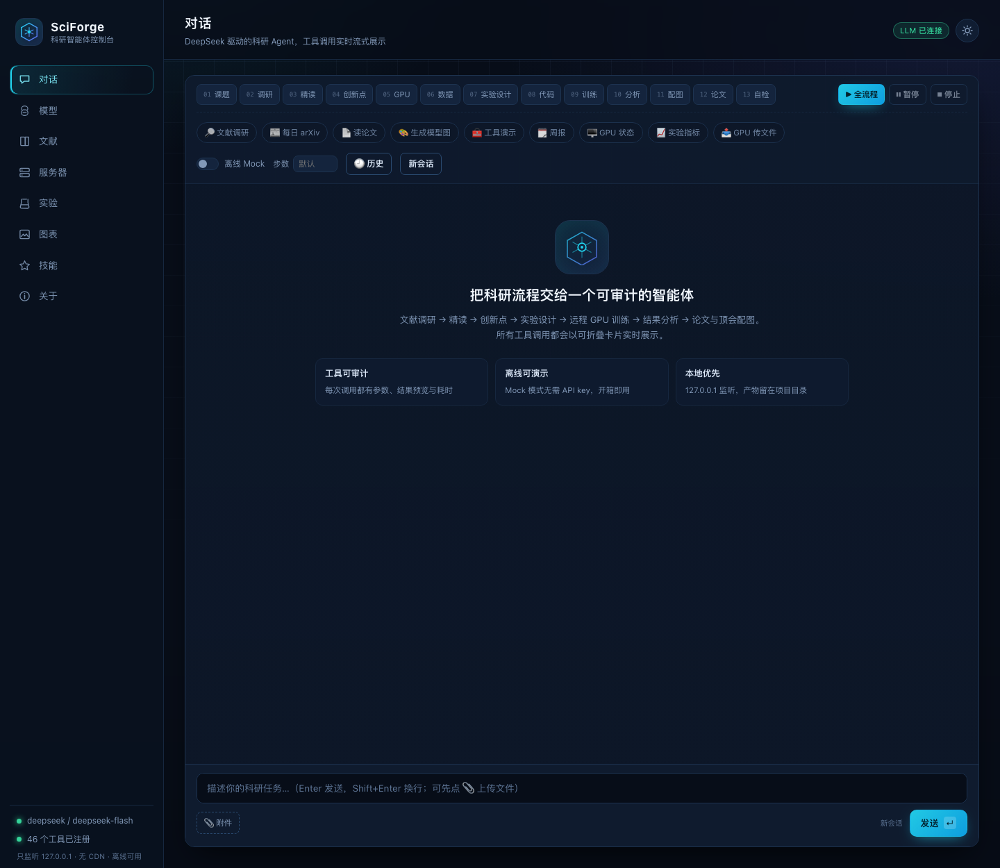
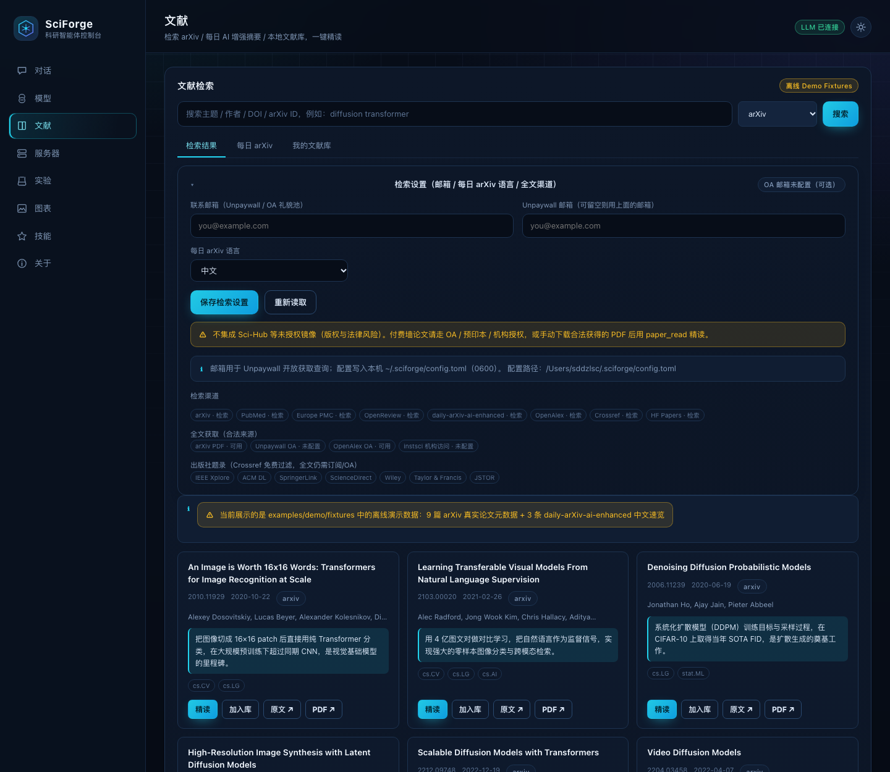
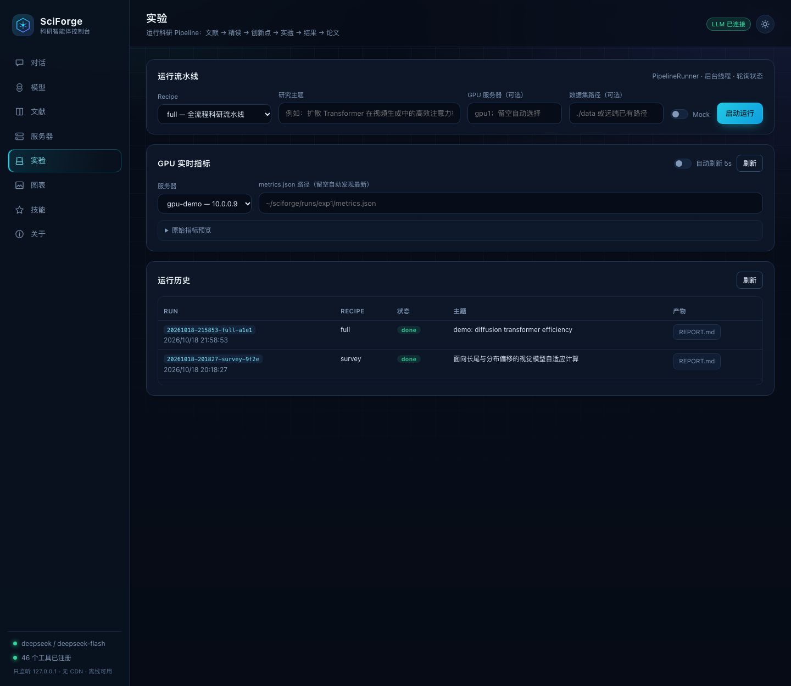
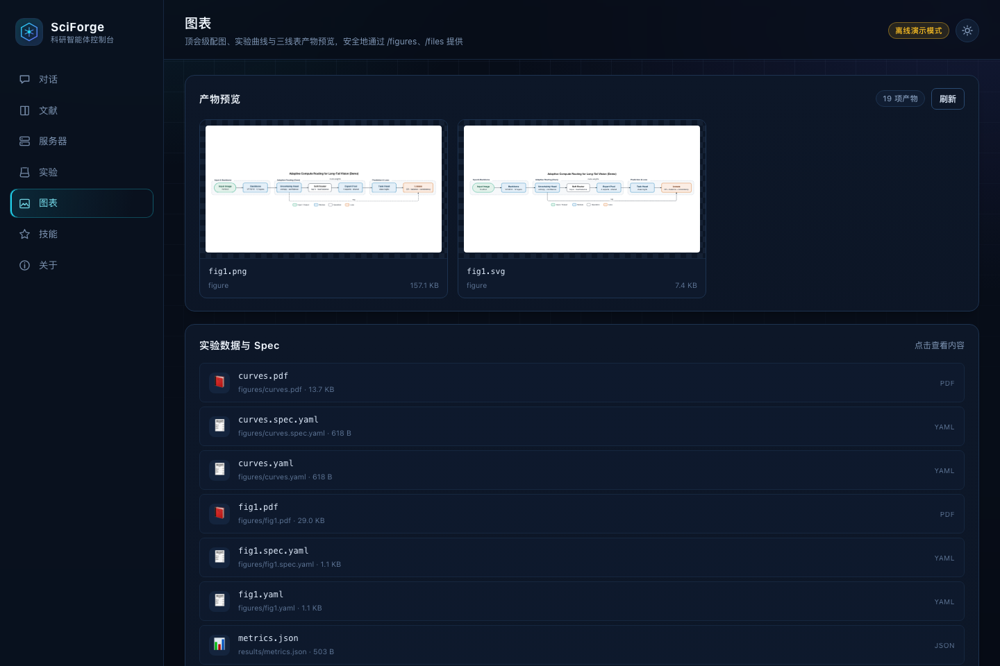
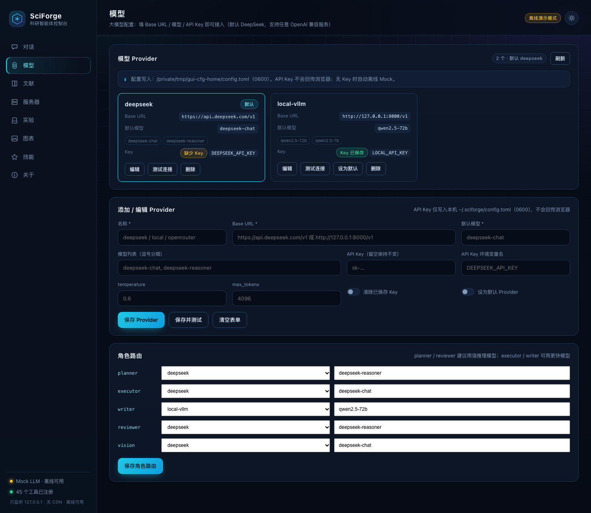
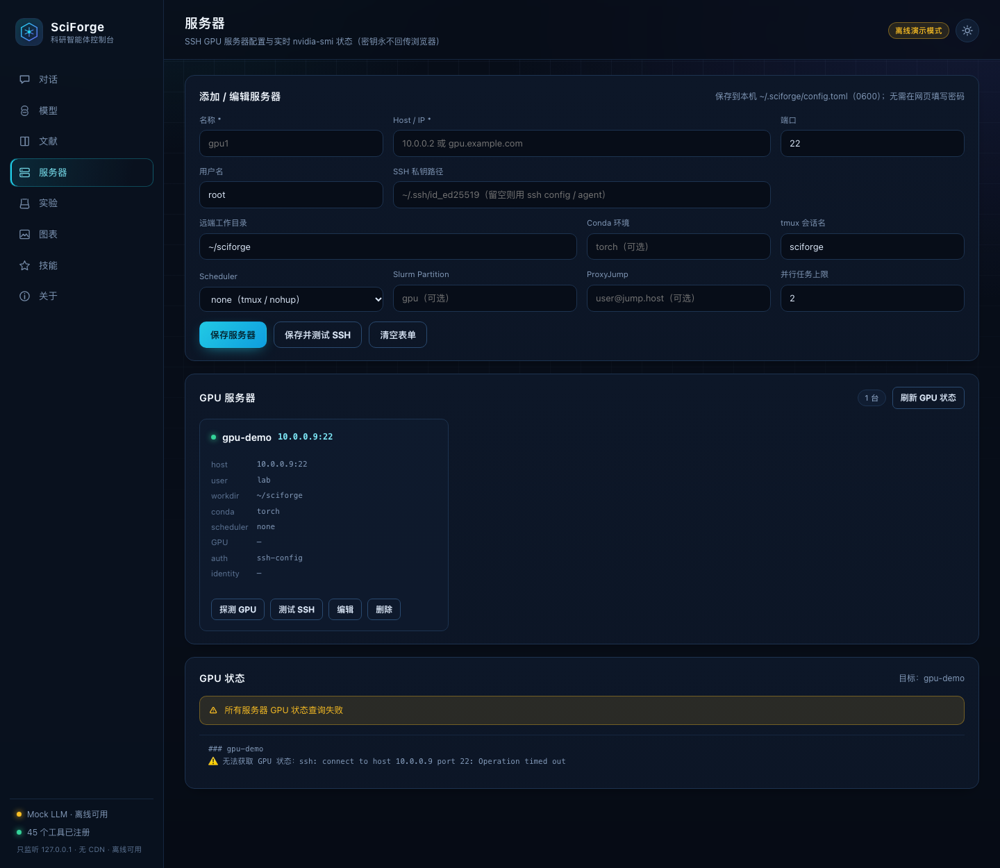
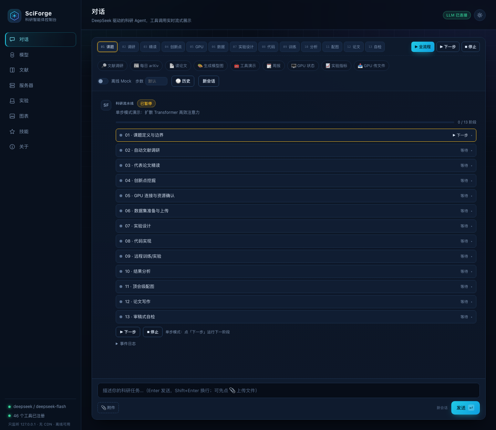
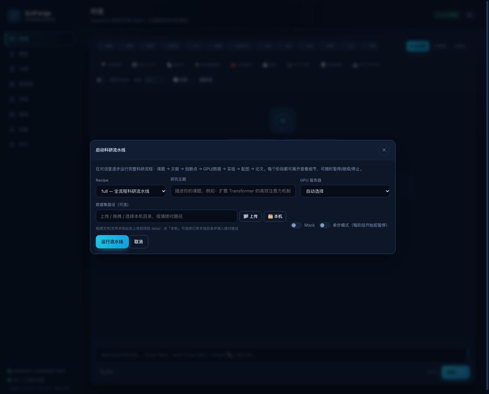

# SciForge · Research Agent Harness for Deep Learning

[English](README.md) | [简体中文](README.zh-CN.md)

[](https://github.com/sddzlsc/SciForge/actions/workflows/ci.yml)
[](https://github.com/sddzlsc/SciForge/releases)
[](https://github.com/sddzlsc/SciForge)
[](LICENSE)

> **Local-first · DeepSeek-powered · SSH GPU orchestration · From literature to publication figures**

SciForge turns deep-learning research into composable modules:
**Skills** (research methodology) + **Tools** (46 deterministic capabilities) +
**Pipelines** (7 recipes) + a local web console. It is not another "chat with papers" wrapper:
it runs the actual research loop — search, read, ideate, train on your GPU box, write, and draw
publication-quality figures — while keeping every tool call auditable.

```text
Literature → Deep-read → Idea mining → Experiments on GPU → Analysis → Paper → Figures
```

## Why SciForge

| Research pain | SciForge's answer |
|---|---|
| Workflow is fragmented across tools | One harness with a shared project state (`research-state.yaml`, `findings.md`, `research-log.md`) |
| LLMs hallucinate citations and numbers | Literature tools only return real search results; writing checks numbers against `results/` files |
| Experiments live on a remote GPU box | Built-in SSH (password or key), tmux/Slurm, file sync, live metrics |
| Figures are an afterthought | Declarative DSL for architecture diagrams, curves, and booktabs tables (SVG/PDF/PNG) |
| Privacy / data leakage | Local-first: listens on `127.0.0.1`, API keys stay on your machine |
| Paywalls and copyright risk | Free public APIs + legal OA only; **no Sci-Hub integration** |

## What's inside

| Module | Capability | Entry points |
|---|---|---|
| 📚 Literature | arXiv, PubMed, Europe PMC, OpenReview, OpenAlex, Crossref (with IEEE/ACM/Springer publisher filters), HF Papers, daily arXiv; BibTeX + legal full text | `sciforge lit ...`, `lit_search` |
| 📖 Deep reading | PDF → section structure → structured notes / comparison matrix / paper Q&A | `sciforge read ...`, `paper_read` |
| 💡 Ideation | Idea cards (gap / insight / method / MVP / risk / score) and proposals | `sciforge idea ...`, `idea_generate` |
| 🧪 Experiments | Design → scaffold (CV / NLP / LLM-SFT) → remote launch → logs → metrics collection | `sciforge exp ...`, `exp_launch` |
| 🖥️ GPU | SSH test, GPU status, sync, tmux/Slurm jobs, log tailing | `sciforge ssh ...`, `sciforge gpu status` |
| ✍️ Writing | LaTeX projects (CVPR/NeurIPS/ICLR/ACL/generic), citations, compile checks, reviewer-style self-check | `sciforge write ...` |
| 🎨 Figures | Conference-style architecture diagrams (declarative DSL → SVG/PDF), plots, booktabs tables | `sciforge fig ...` |
| 🧩 Orchestration | Recipe pipelines with resumable stage artifacts | `sciforge pipeline ...` |
| 🖥️ Web console | Local GUI: streaming chat (Markdown + offline KaTeX math), **in-chat pipeline with expandable stages + pause/resume/stop**, literature, GPU, experiments, figures, skills, models | `sciforge serve` |
| 🤝 DSH | Install skills into DSH (DeepSeek Harness) and drive SciForge from the host agent | `sciforge dsh install` |

## Screenshots

















## Quickstart

### 1. Install (Python ≥ 3.10)

```bash
git clone https://github.com/sddzlsc/SciForge.git sciforge && cd sciforge
uv venv --python 3.12 .venv
source .venv/bin/activate
uv pip install -e ".[dev]"
# optional extras: uv pip install -e ".[pdf,web,fig]"
```

### 2. Initialize a project

```bash
sciforge init my-project --name "My Project" --topic "spatio-temporal consistency in video generation"
export DEEPSEEK_API_KEY=sk-...
sciforge doctor      # check LLM / tools / servers / skills / LaTeX
```

### 3. Zero-cost demo (no API key or GPU required)

```bash
sciforge demo        # offline: literature → reading → ideas → figures → paper skeleton
sciforge demo --web  # also launch the local web console
```

### 4. Real research

```bash
sciforge chat "survey diffusion transformers for video generation and propose 3 actionable ideas"
sciforge pipeline run --recipe survey --topic "spatio-temporal consistency in video generation"
sciforge pipeline run --recipe full   --topic "..."   # end-to-end
```

### Agent step budget

One "step" is one LLM decision round plus the tools it calls. The default budget is **30 steps per task**:
typical tasks finish in 3–8 steps, while 30 leaves headroom for multi-tool surveys without allowing
runaway loops. Configure it from the GUI chat toolbar (**步数** field), the CLI (`--max-steps`), the
HTTP API (`max_steps`), or `~/.sciforge/config.toml`:

```toml
[agent]
max_steps = 30   # 0 = no limit (use with care)
```

`0` disables the cap; a run still stops when the model returns no tool calls, on an LLM error, or when
you press Stop / Ctrl-C. For long autonomous runs prefer a large finite number (e.g. 100–200) rather
than a true infinite loop, since unlimited runs can consume unbounded tokens and time. Pipeline
stages have their own smaller budgets (10–18) defined in `sciforge/pipeline/recipes.py`.

## Free literature sources (no subscription)

| Source | Coverage | What you get |
|---|---|---|
| arXiv | CS / physics / math / AI preprints | metadata + abstracts + PDF |
| OpenAlex | 250M+ works across venues | metadata, authors, citations, OA links |
| Crossref | DOI metadata for all publishers | authoritative metadata + BibTeX (+ publisher filters) |
| PubMed | Medicine / life sciences | metadata + abstracts via NCBI E-utilities |
| Europe PMC | PubMed + PMC + preprints | metadata + abstracts + OA full-text links |
| OpenReview | ICLR / NeurIPS / ICML etc. | metadata + abstracts + reviews + PDF |
| HF Papers / daily-arXiv | curated daily AI papers | metadata + Chinese summaries |

Publisher metadata (IEEE, ACM, Springer, Elsevier, Wiley, Taylor & Francis, JSTOR) can be searched
through Crossref member filters for free; full text still requires a subscription or an OA copy.
No Sci-Hub, no paywall bypassing.

## Connect your GPU server

Add servers in `~/.sciforge/config.toml` (or via the GUI form):

```toml
[[servers]]
name = "gpu1"
host = "10.0.0.2"
port = 22
user = "root"
identity_file = "~/.ssh/id_ed25519"
workdir = "~/sciforge"
conda_env = "torch"
tmux_session = "sciforge"
# password_env = "GPU1_PASSWORD"   # or password = "..." (stored 0600)
# scheduler = "slurm"
# partition = "gpu"
# proxy_jump = "user@jump.example.com"
```

Common commands:

```bash
sciforge ssh test gpu1
sciforge gpu status
sciforge gpu status gpu1 --watch
sciforge ssh sync gpu1
sciforge ssh run gpu1 "nvidia-smi"

sciforge exp scaffold --template cv-classification --name vit-routing
sciforge exp launch --server gpu1 --script scripts/run.sh --name vit-routing-a
sciforge exp status
sciforge exp logs vit-routing-a --tail 80
sciforge exp results
```

Long jobs always run in the background (tmux or Slurm); SciForge returns the job id and log path
instead of blocking. Every run records command, seed, git commit, server, logs, and metrics.

## Research workflows

```bash
sciforge pipeline list
sciforge pipeline run --recipe survey     --topic "..."
sciforge pipeline run --recipe experiment --topic "..."
sciforge pipeline run --recipe paper      --topic "..."
sciforge pipeline run --recipe full       --topic "..."   # --until to stop early
sciforge pipeline runs
sciforge pipeline show <run-id>
```

The `full` recipe now follows the real research loop in **13 stages**:

```text
scope → literature survey → deep-read → idea mining
→ GPU connectivity check → dataset upload
→ experiment design → code → remote run → analysis
→ publication figures → paper writing → reviewer self-check
```

Optional inputs (empty = auto-detect / auto-select):

```bash
sciforge pipeline run --recipe full --topic "..." --server gpu1 --dataset ./data
```

The GUI experiment page exposes the same `GPU server` / `dataset path` fields and shows live
per-stage status and artifacts.

### Run the pipeline inside the chat (pausable)

The chat toolbar now shows all 13 pipeline stages **in order** at the top (scope → survey → read →
ideate → GPU → data → design → code → run → analyze → figures → write → review). Click **▶ Full
pipeline** to configure and start:

- the top stage bar shows each stage's live state (pending / running / done / failed / next); click to jump to details
- click a single stage to run **just that stage** as its own run (also pausable/stoppable)
- with **step mode**, the pipeline pauses before every stage; click **▶ Next step** to advance
- the **dataset path** field supports 📁 upload, drag-and-drop of files/folders (saved to `<project>/data/`),
  or 🗂 picking an existing local directory (auto-fills the absolute path); remote paths are also accepted
- the run appears as a message in the conversation:

- stage-by-stage status, duration and artifacts; **click a stage to expand its full output**
- **⏸ pause / ▶ resume / ⏹ stop** at any time (pause takes effect at the next LLM step or stage boundary)
- event log with stage transitions, tool calls and model steps
- when finished: open the full report or download per-stage artifacts
- the pipeline runs in the background, so the chat stays responsive
- reloading the page restores the active pipeline card and its controls

The Experiments page still keeps the historical run list for comparison; stale `running` runs left by a
server restart can be stopped from the history table with **⏹ Stop**.

Each run writes resumable artifacts:

```text
.sciforge/runs/<run_id>/
├── run.json
├── REPORT.md
├── 01-survey/output.md
├── 02-read/output.md
└── ...
research-state.yaml   # project-level state (autoresearch-style)
findings.md           # evolving synthesis
research-log.md       # decision timeline
```

## Paper writing and publication figures

```bash
sciforge write draft --venue cvpr --title "..." --authors "A, B"
sciforge write compile path/to/paper
sciforge fig arch --spec examples/demo/fixtures/arch_spec.yaml --out figures/fig1
sciforge fig plot --spec examples/demo/fixtures/plot_spec.yaml --out figures/curves
sciforge fig table --spec ... --out figures/table1
```

Outputs are vector-first (SVG/PDF/PNG) and reproducible from specs, so figures can be regenerated
for camera-ready revisions.

## Skills and DSH integration

SciForge ships **24 research skills** (literature survey, paper deep-read, ideation, experiments,
figure design, paper writing, rebuttal, reproducibility, distributed training, and more) and a
catalog of **20 external research-skill sources**.

```bash
sciforge skills list
sciforge skills install sciforge-harness --target ~/.dsh/skills
sciforge dsh install
sciforge skills catalog
```

Skills follow the Agent Skills / DSH / Claude Code `SKILL.md` conventions, so hosts can load them
directly.

## Use any OpenAI-compatible LLM

The default routes are `deepseek-flash` (executor / writer / vision) and `deepseek-v4-pro`
(planner / reviewer), but every provider is configurable via GUI or `config.toml`:

```bash
sciforge llm provider add local --base-url http://127.0.0.1:8000/v1 --model qwen2.5-72b
sciforge llm provider add openrouter --base-url https://openrouter.ai/api/v1 --model ...
sciforge llm roles set planner deepseek --model deepseek-v4-pro
sciforge llm test
```

No API key? The whole project still runs in offline **Mock** mode for demos and tests.

## Local web console

```bash
sciforge serve --port 8765
# or: sciforge gui
```

The console is a zero-build, no-CDN single-page app: streaming chat with collapsible tool cards,
file attachments, GPU status and live metrics, experiment runs, figure gallery, literature search,
model/server configuration, skill manager, and session history. It binds to `127.0.0.1` only and
never sends secrets to the browser.

## Repository layout

```text
sciforge/
├── agent/       # ReAct loop, runtime, prompts
├── core/        # types, tool registry, event bus
├── llm/         # OpenAI-compatible router, mock provider, cost tracking
├── tools/       # literature / reading / SSH / experiments / figures / writing / skills / ideation
├── pipeline/    # stages, recipes, runner
├── figures/     # architecture diagrams, plots, tables
├── writing/     # LaTeX projects, citations, compile checks
├── skills_lib/  # 24 SKILL.md research skills
├── web/         # FastAPI + vanilla HTML/CSS/JS console
└── cli.py       # Typer CLI
```

## Verification

- **355 offline tests** (`pytest -q`), 2 integration tests skipped by default
- **Ruff** clean
- **CI** on GitHub Actions: Python 3.10 and 3.12
- Demo fixtures and offline Mock mode make the full loop reproducible without network access

```bash
pytest -q
ruff check sciforge tests
bash scripts/verify.sh
```

## Docs

Documentation is currently Chinese-first; English translations are welcome.

- [docs/QUICKSTART.md](docs/QUICKSTART.md) — installation and first project
- [docs/LITERATURE.md](docs/LITERATURE.md) — free sources, legal full text, publisher filters
- [docs/REMOTE_GPU.md](docs/REMOTE_GPU.md) — SSH password/key, tmux/Slurm, troubleshooting
- [docs/ARCHITECTURE.md](docs/ARCHITECTURE.md) — interface contracts and module layout
- [docs/SKILLS.md](docs/SKILLS.md) — skill system and DSH integration
- [docs/VERIFICATION.md](docs/VERIFICATION.md) — verification evidence

## Roadmap & limitations

- `v0.2.0` is an MVP: you need your own LLM API key and a reachable GPU host
- PDF parsing quality depends on the paper layout and the model; complex equations may fail
- Chinese databases (CNKI, Wanfang, VIP) and Web of Science / Scopus have no free APIs; use
  institutional access manually
- SciForge is a research workflow harness, not a "one-click paper generator". Novelty judgment and
  final responsibility stay with the researcher

## Acknowledgements

SciForge builds on ideas and interfaces from
[huggingface/ml-intern](https://github.com/huggingface/ml-intern),
[k-dense-ai/scientific-agent-skills](https://github.com/k-dense-ai/scientific-agent-skills),
[InternScience/Awesome-Scientific-Skills](https://github.com/InternScience/Awesome-Scientific-Skills),
[dw-dengwei/daily-arXiv-ai-enhanced](https://github.com/dw-dengwei/daily-arXiv-ai-enhanced),
[Rimagination/instsci](https://github.com/Rimagination/instsci),
[orchestra-research/AI-research-SKILLs](https://github.com/orchestra-research/AI-research-SKILLs),
and the DeepSeek Harness ecosystem.

## License

MIT. If SciForge helps your research, please ⭐ star the repo — it helps others find it.
