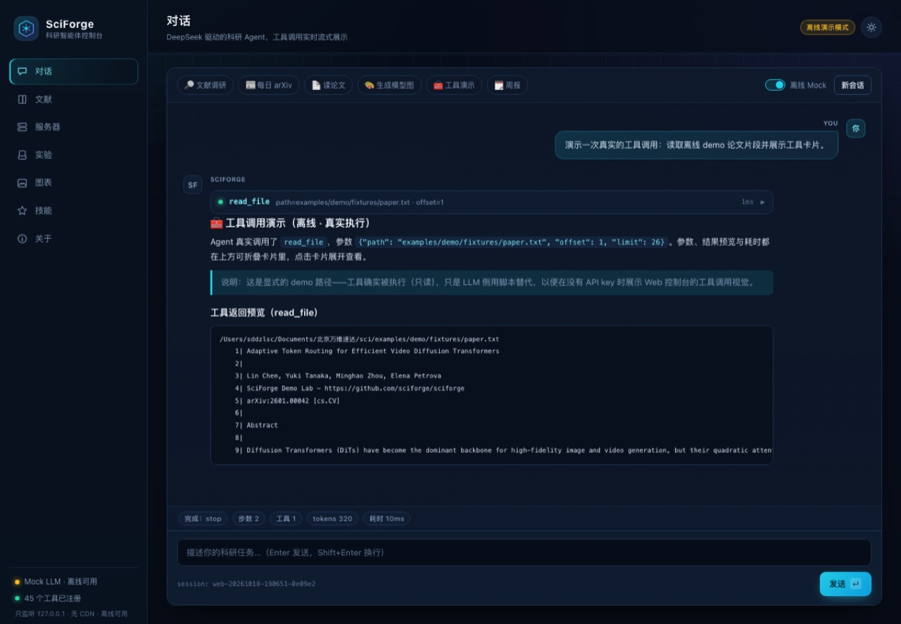
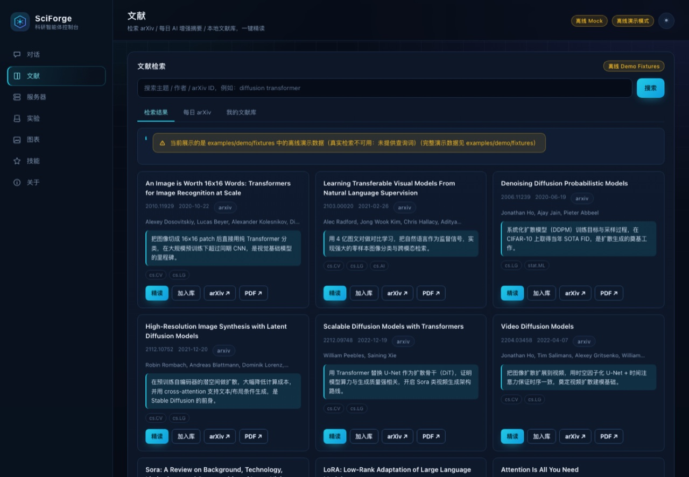
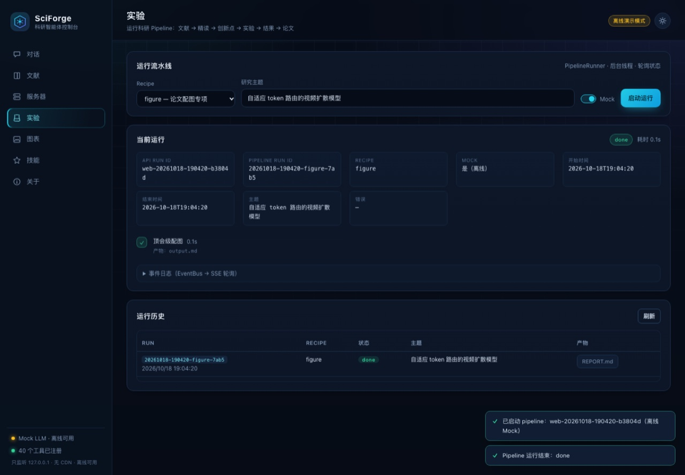

# SciForge Demo：从文献到论文的一条龙演示

这是一组 **离线可跑** 的演示素材与脚本，用同一篇虚构论文
《Adaptive Token Routing for Efficient Video Diffusion Transformers》串起 SciForge 的完整科研流水线：

```
文献检索 → 论文精读 → 创新点挖掘 → 实验设计 → GPU 训练（可 mock）→ 结果分析
        → 论文写作 → 顶会级配图（架构图 / 曲线 / 三线表）→ 审稿式自检
```

所有数据在 [`fixtures/`](fixtures/README.md)，不联网、不需要 API key（Mock LLM 模式）。

## 目录

```
examples/demo/
├── README.md            # 本文件
├── make_fixtures.py     # 生成/校验 fixtures（pymupdf 生成 4 页示例论文 PDF）
└── fixtures/
    ├── README.md        # 每个 fixture 的字段说明
    ├── arxiv_search.json    # 9 篇真实 arXiv 论文元数据
    ├── daily_arxiv.jsonl    # 3 行 daily-arXiv-ai-enhanced 中文增强摘要
    ├── paper.pdf / paper.txt # 4 页示例论文（Abstract → Conclusion）
    ├── arch_spec.yaml       # Figure 1 模型架构图 DSL
    ├── arch_preview.svg     # 架构图渲染预览（图表页展示用）
    ├── paper_preview.png    # paper.pdf 首页缩略图（图表页展示用）
    ├── plot_spec.yaml       # Figure 2 训练曲线 spec
    └── results/metrics.json # 主结果 / 消融 / 效率 / 训练曲线数据
```

## 快速开始

```bash
# 0) 生成示例论文 PDF（已提交，一般无需重复执行）
.venv/bin/python examples/demo/make_fixtures.py

# 1) 全流程演示（离线 Mock，无需 API key；生成到当前项目 .sciforge/runs/）
sciforge pipeline run --recipe full \
  --topic "自适应 token 路由的视频扩散模型" --mock

# 或分步执行：
sciforge lit search "video diffusion transformer" --source arxiv --limit 10
sciforge read examples/demo/fixtures/paper.pdf --note
sciforge idea --topic "自适应 token 路由的视频扩散模型"
sciforge fig arch --spec examples/demo/fixtures/arch_spec.yaml -o figures/fig1_arch.svg
sciforge fig plot --spec examples/demo/fixtures/plot_spec.yaml -o figures/fig2_curves.pdf
sciforge fig table --spec examples/demo/fixtures/results/metrics.json -o tables/table1.tex
sciforge write draft --venue cvpr
sciforge write review
```

## Web 控制台演示（推荐给别人看时使用）

```bash
.venv/bin/python -m sciforge.web.server --port 8765
# 或者 sciforge serve --port 8765
# 浏览器打开 http://127.0.0.1:8765
```

1. **对话页**：默认勾选「离线 Mock」。点「文献调研」chip，观察
   `llm_delta` 流式输出与事件状态；点「工具演示」chip 会触发一次**真实**的
   `read_file` 工具调用（读取 `fixtures/paper.txt`），展示工具折叠卡片
   （工具名 / 参数 / 结果预览 / 耗时）；真实模式下 LLM 的每次工具调用同样渲染成卡片。
2. **文献页**：检索框直接搜索 `diffusion transformer`。真实检索未就绪时自动回退到
   `fixtures/arxiv_search.json`（页面有「离线 Demo Fixtures」标记）。点击「精读」
   自动跳转对话页并发送精读任务；点击「加入库」写入本地文献库。
3. **服务器页**：未配置 SSH 时给出明确提示；配置后点「刷新 GPU 状态」查看
   nvidia-smi 归一化表格（无 NVIDIA GPU 的 Mac 会显示 MPS 提示）。
4. **实验页**：选择 recipe（如 `figure`）+ 主题 → 启动 mock pipeline，阶段进度、
   EventBus 事件与产物文件实时刷新；完成后可在图表页看到 run 产物。
5. **图表页**：展示 `arch_preview.svg`、`paper.pdf` 及 spec / metrics 文件预览；
   真实运行时展示 `figures/`、`results/`、`.sciforge/runs/` 下的产物。
6. **技能页**：`skills_lib` 技能列表，一键「安装到 DSH」（写入 `~/.dsh/skills/`）。
7. **关于页**：模块就绪度（T1 文献库 / T2 远程 GPU / T3 配图写作 / T4 技能）、API 端点清单与安全边界。

## 演示脚本（3 分钟版）

> 目标：让观众看到「文献 → 精读 → 创新点 → 实验 → 图 → 论文」全部环节都有真实产物落盘。

1. 打开 Web 控制台，对话页发一句：
   「帮我调研扩散 Transformer 在视频生成中的高效注意力机制，给出研究空白和 3 个可做方向。」
   （再点「工具演示」chip，展示工具调用折叠卡片的真实数据流。）
2. 切到文献页搜索 `video diffusion`，把 DiT / Video Diffusion 两篇「加入库」，再点一篇「精读」。
3. 切到实验页，recipe 选 `figure`，主题填「自适应 token 路由的视频扩散模型」，点启动；
   1–2 秒后看到阶段完成、`REPORT.md` 产物链接。
4. 切到图表页：查看架构图预览、`paper.pdf`、`plot_spec.yaml`、`results/metrics.json`。
5. 点「关于」展示模块就绪度与安全边界（127.0.0.1、防目录穿越、密钥不回传）。

## 界面截图（深色主题）

| 对话：流式输出 + 工具调用折叠卡 | 文献：离线 fixtures 检索卡片 | 实验：mock pipeline 运行状态 |
|---|---|---|
|  |  |  |

截图由本地控制台（`sciforge serve`）实际运行后截取；工具卡片中的 `read_file`
调用是「工具演示」chip 触发的真实工具执行。浅色主题可在右上角切换。

## 说明与限制

- Mock 模式生成的是**流程演示文本**，不是真实科研结论；配置 `DEEPSEEK_API_KEY` 后
  重新运行同一 pipeline 即可得到真实模型输出。
- 示例论文与其实验数值为虚构内容，仅用于演示 `paper_read` / 写作 / 配图流程。
- `paper.pdf` 由 `make_fixtures.py` 生成，重新生成不会改变内容（无随机性）。
- 如果个别模块（T1–T4）尚未就绪，Web 控制台会明确显示「未就绪（优雅降级）」，
  并使用本目录 fixtures 兜底，不会崩溃。
